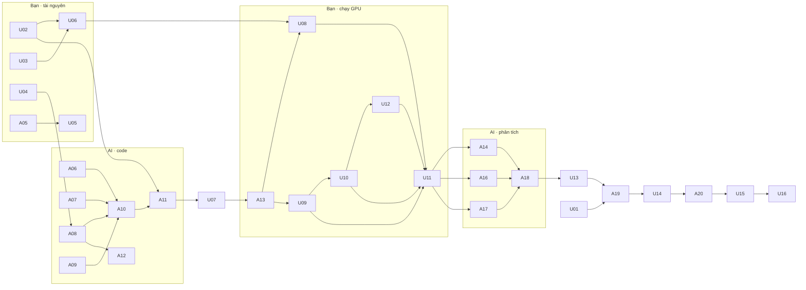

# Checklist dự án LinCIR — ai làm gì, cái gì cần cái gì

Ký hiệu người làm: 🤖 **AI** (Claude Code) · 👤 **Bạn** (Tâm) · 👥 **Nhóm** (cả 5 người)
Trạng thái: `[x]` xong · `[ ]` chưa · `[~]` đang làm · `[!]` bị chặn (ghi lý do) · `[–]` bỏ / đã thay bằng việc khác
Cột **Cần** là các việc phải xong trước (đầu vào). Cột **Ra** là sản phẩm (đầu ra) mà việc sau dùng.
Cột **Nhóm** là task id tương ứng trong checklist chung trên artifact (nếu có).

Cập nhật lần cuối: 2026-10-07 (chốt phương án nhanh)

## Giai đoạn 0 — Nền tảng

| | ID | Ai | Việc | Cần | Ra | Nhóm |
|---|---|---|---|---|---|---|
| [x] | A01 | 🤖 | Đọc hiểu bài báo, tóm tắt bài toán, phương pháp, kết quả | PDF bài báo | Tóm tắt; bảng số liệu tham chiếu trong `CLAUDE.md` | p1-1 |
| [x] | A02 | 🤖 | Dựng cấu trúc dự án, `CLAUDE.md`, skill, `.gitignore` | A01 | Thư mục `BTL-LinCIR/` | — |
| [x] | A03 | 🤖 | Kế hoạch 8 tuần + checklist nhóm (artifact) | A01 | https://claude.ai/artifact/Jons1Eq7odXT2kWWt4iYwj | — |
| [x] | A04 | 🤖 | `scripts/stats_compare.py` (đã chạy thử trên dữ liệu giả lập) | — | Script kiểm định | — |

## Giai đoạn 1 — Quyết định và tài nguyên (chỉ người làm được)

| | ID | Ai | Việc | Cần | Ra | Nhóm |
|---|---|---|---|---|---|---|
| [x] | U01 | 👤 | Xác nhận hạn nộp và yêu cầu của giảng viên (định dạng báo cáo, số trang, thời lượng thuyết trình) | — | Ghi vào `docs/decisions.md` | — |
| [x] | U02 | 👤 | Chọn máy: **Kaggle GPU T4×2** (16GB/card) để train, **Mac mini M1** để code, chạy thử, demo | — | Kaggle: Python 3.13, torch 2.11+cu128, CUDA OK, 20GB `/kaggle/working` → A11 | p1-4 |
| [–] | U03 | 👤 | Đăng ký tải ảnh NLVR2 cho CIRR — **đã gửi form 2026-10-06, chờ duyệt (thường ≤ 1 tuần, tới ~2026-10-13)**. Quá hạn thì email `nlvr@googlegroups.com` hoặc liên hệ nhóm CIRR | — | Quyền tải ảnh CIRR → U06 | p1-5 |
| [ ] | U04 | 👥 | Họp chốt hướng cải tiến (A chính, B phụ, C dự phòng) và phân công | A03 | Ghi vào `docs/decisions.md` → A08 | p3-1 |
| [ ] | U05 | 👤 | Đồng ý để AI tạo commit đầu tiên (A05), rồi tạo repo GitHub, push, mời 4 thành viên | A05 | Repo dùng chung | p1-3 |

## Giai đoạn 2 — Viết code (AI làm trên máy này, không cần GPU)

| | ID | Ai | Việc | Cần | Ra | Nhóm |
|---|---|---|---|---|---|---|
| [ ] | A05 | 🤖 | Commit đầu tiên (chỉ khi Bạn đồng ý) | A02 | Commit `main` → U05 | p1-3 |
| [x] | A06 | 🤖 | Sửa lỗi `arg` → `args` ở `train_phi.py:249` | — | Code gốc chạy được với `--max_grad_norm` | — |
| [x] | A07 | 🤖 | `scripts/eval_per_query.py`: đánh giá CIRR dev + FashionIQ, xuất `metrics.json` và `per_query_*.csv` | — | Script → U08, U09, U10 | p2-3 |
| [x] | A08 | 🤖 | Code cải tiến, mỗi hướng một cờ, mặc định tắt: A `--infonce_weight`, B `--gap_noise_alpha` + script tính Δ, C `--idf_keywords` + script tính IDF | U04 (có thể làm trước, chỉnh sau) | Code A, B, C → A10, U10 | p3-2, p3-3 |
| [x] | A09 | 🤖 | `scripts/modality_gap.py`: đo modality gap, phân bố cosine cặp đúng/sai | — | Script → U12 | p2-5 |
| [x] | A10 | 🤖 | Làm code tương thích môi trường mới (Python 3.13, torch 2.11, transformers mới: `encode_with_pseudo_tokens.py` gọi `encoder(causal_attention_mask=...)`, thiếu gói `clip` của OpenAI), rồi chạy thử trên M1 (backbone nhỏ, vài chục bước). Không lấy số liệu | A06, A07, A08, A09 | Code chạy được, `requirements.txt` có ghim phiên bản | — |
| [x] | A11 | 🤖 | Notebook **Kaggle** chạy trọn quy trình: cài đặt → gắn dữ liệu từ Kaggle Dataset → train → đánh giá → ghi kết quả vào `/kaggle/working`; chạy được bằng Save Version | U02, A10 | `notebooks/kaggle_lincir.ipynb` → U07–U12 | — |
| [x] | A12 | 🤖 | Config cho mọi thí nghiệm: EXP-001 baseline, 002 A, 003 B, 004 A+B, 005 quét λ, 006 quét α (+ 007 C nếu dùng) | A08 | `configs/EXP-*.yaml` → U09, U10 | — |

## Giai đoạn 3 — Chạy thực nghiệm (Bạn/Nhóm chạy trên máy GPU)

| | ID | Ai | Việc | Cần | Ra | Nhóm |
|---|---|---|---|---|---|---|
| [–] | U06 | 👤 | ~~Tải CIRR (ảnh dev) và FashionIQ, tải lên Kaggle thành Dataset riêng tư; giữ một bản trên M1 cho demo~~ (thay bằng U17 (FashionIQ + CIRCO); CIRR → U21) | U03, U02 | Kaggle Dataset + `data/CIRR`, `data/FashionIQ` | p1-5 |
| [x] | U07 | 👤 | Chạy notebook Kaggle ở `MODE="smoke"` (dữ liệu giả, **không cần chờ U03/U06**): upload bundle, gắn input, Save & Run All; gửi AI ảnh/log ô smoke hoặc file `results_smoke_*.zip` | A11 | Tốc độ s/bước, bộ nhớ GPU, xác nhận ViT-L + checkpoint chính thức chạy trên Kaggle → A13 | p1-4 |
| [x] | A13 | 🤖 | Đọc log, sửa lỗi môi trường hoặc code nếu có | U07 | Code chạy ổn trên GPU | — |
| [–] | U08 | 👤 | ~~Đánh giá checkpoint chính thức `lincir_large.pt`~~ (đã làm trong U17 (EXP-000)) | A13 | `runs/EXP-000-official/` → A14 | p2-1 |
| [–] | U09 | 👤 | ~~Train baseline EXP-001 với 3 seed, rồi đánh giá~~ (thay bằng U18 + các phiên train sau) | A13, A12 | `runs/EXP-001-*` (per-query CSV) → A14, A16 | p2-2, p2-4 |
| [–] | U10 | 👤 | ~~Train EXP-002…006 với 3 seed mỗi cấu hình, rồi đánh giá~~ (thay bằng U18 + các phiên train sau) | U09, A12 | `runs/EXP-002…006-*` → A16 | p3-4, p3-5 |
| [–] | U12 | 👤 | ~~Chạy `modality_gap.py` và xuất top-5 kết quả cho 10 truy vấn mẫu (baseline và bản tốt nhất)~~ (gộp vào phiên eval (modality gap + top-k)) | A09, U10 | `runs/*/gap.json`, `runs/*/topk_examples.json` → A17 | p2-5, p4-4 |
| [–] | U11 | 👤 | ~~Chép toàn bộ `experiments/runs/` (trừ file `.pt`) về repo hoặc máy này~~ (thay bằng tải results_*.zip mỗi phiên) | U08, U09, U10, U12 | Kết quả ở chỗ AI đọc được | — |

## Phương án nhanh (Bạn chốt 2026-10-07) — thay cho U06, U08–U10 cũ

FashionIQ val (bản sao HF `royokong/fashioniq_val_imgs`) + CIRCO val (COCO unlabeled2017) thay CIRR; CIRR bổ sung khi NLVR2 duyệt.
K = 5.000 bước cho mọi biến thể, không quét λ/α (λ = α = 0.5), dùng checkpoint bước cuối (không chọn theo tập đánh giá), 2 run song song trên 2 T4.

| | ID | Ai | Việc | Cần | Ra | Nhóm |
|---|---|---|---|---|---|---|
| [x] | A21 | 🤖 | `scripts/prepare_eval_data.py`: FashionIQ val (HF + chú thích GitHub), CIRCO val (chú thích GitHub + COCO unlabeled2017, bản "lite" chỉ giữ ảnh truy vấn), COCO val2017 + captions (cho Δ) | — | Script → A23 | p1-5 |
| [x] | A22 | 🤖 | CIRCO trong `eval_per_query.py` (mAP@5/10/25/50, per-query), `run_experiment.py --circo` | — | Script → A23 | p2-3 |
| [x] | A24 | 🤖 | Config K=5.000 (checkpoint mỗi 500 bước), quyết định ghi `docs/decisions.md` | — | `configs/EXP-00[1-4]` cập nhật → A23 | — |
| [x] | A23 | 🤖 | Notebook: MODE `prep_eval` / `train` (2 GPU song song, chặn trước giới hạn 12 giờ) / `eval` (đánh giá run từ output phiên trước) | A21, A22, A24 | `notebooks/kaggle_lincir.ipynb` + bundle mới → U17 | — |
| [x] | A25 | 🤖 | Chạy thử toàn bộ chế độ mới trên Mac (dữ liệu giả, 2 run song song CPU/MPS) | A23 | Xác nhận trước khi đưa lên Kaggle | — |
| [x] | U17 | 👤 | Phiên **prep_eval** (~1–1,5 giờ): tải gói mới, Save & Run All | A25 | Output: dữ liệu lite, cache đặc trưng, Δ, EXP-000 | p1-5, p2-1 |
| [x] | U18 | 👤 | Phiên **train 1** (~10 giờ): baseline × 3 + A × 3 | A25 | Output: 6 run | p2-2, p3-4 |
| [–] | U19 | 👤 | ~~Phiên **train 2** (~10 giờ): B × 3 + A+B × 3; gắn output U17 (Δ)~~ (thay bằng hàng đợi train (U22, U24)) | U17 | Output: 6 run | p3-4 |
| [–] | U20 | 👤 | ~~Phiên **eval** (~2–3 giờ): gắn output U17, U18, U19~~ (thay bằng U23 (eval sớm) + U25 (eval cuối)) | U17, U18, U19 | `results_eval_*.zip` → A14, A16, A17 | — |
| [–] | U21 | 👤 | ~~(Khi NLVR2 duyệt) phiên eval bổ sung CIRR~~ (bỏ 2026-10-08: duyệt NLVR2 muộn hơn hạn báo cáo) | U03, U20 | Kết quả CIRR | p2-1 |

## Lịch phiên Kaggle còn lại (cập nhật 2026-10-08)

Mỗi phiên gắn Input = **Version mới nhất** của notebook (carry-forward mang theo mọi thứ). Kiểm tra `MODE` trước khi Save & Run All; tắt phiên soạn thảo (⏻) khi không dùng.

| | ID | Ai | Việc | Cần | Ra | Nhóm |
|---|---|---|---|---|---|---|
| [x] | U22 | 👤 | Phiên **train 2** (`MODE="train"`, ~11 giờ): baseline + A seed 2024, 7; B + A+B seed 12345 | U18 | 6 run → U23 | p2-4, p3-4 |
| [ ] | U23 | 👤 | Phiên **eval sớm** (`MODE="eval"`, ~2 giờ): import lại notebook, đánh giá mọi run đã train + đường học + modality gap; gửi `results_eval_*.zip` | U22 | Kết quả baseline vs A đủ 3 seed → A16 | p4-1 |
| [x] | U24 | 👤 | Phiên **train cuối** (`MODE="train"`, ~2,5 giờ, làm được ngay trong tuần này): B + A+B seed 7 | U22 | 4 run → U25 | p3-4 |
| [x] | U25 | 👤 | Phiên **eval cuối** (`MODE="eval"`, ~1,5 giờ; tự bỏ run đã đánh giá) | U24 | Đủ 12 run → A16–A18 | p4-1 |

## Giai đoạn 4 — Phân tích và chứng minh (AI)

| | ID | Ai | Việc | Cần | Ra | Nhóm |
|---|---|---|---|---|---|---|
| [x] | A14 | 🤖 | So sánh bảng tái hiện (checkpoint chính thức, baseline nhóm) với bài báo, giải thích chênh lệch | U08, U09, U11 | `results/tables/reproduction.md` | p2-6 |
| [x] | A16 | 🤖 | Skill `compare-results`: mean ± std, paired bootstrap, Wilcoxon, bảng chính, ablation | U10, U11 | `results/tables/main_results.md`, `significance.md`, `ablation.md` | p4-1, p4-2 |
| [x] | A17 | 🤖 | Phân tích cơ chế "tại sao tốt hơn": modality gap, cosine, theo nhóm truy vấn; vẽ hình định tính | U12, U11 | `results/figures/*`, `results/tables/analysis.md` | p4-3, p4-4 |
| [x] | A18 | 🤖 | Đề xuất danh sách run và bảng để đóng băng | A14, A16, A17 | Bản nháp `results/FROZEN.md` → U13 | — |
| [x] | U13 | 👤 | Duyệt và chốt đóng băng kết quả | A18 | `results/FROZEN.md` chính thức → A19 | p4-5 |

## Giai đoạn 5 — Báo cáo, slides, thuyết trình

Yêu cầu (U01, 2026-10-08): báo cáo **.docx, 25–30 trang**, theo mẫu `/Users/tamdv/Documents/Workspace/Master/3.HĐHM/NOS – 2025-2 - Nhóm 10.docx` (A4, lề 3,5/3,5/3/3 cm, Times New Roman 13, giãn dòng 1,5; bìa khung + logo PTIT + bảng giảng viên/lớp/nhóm/học viên; mục lục, danh mục hình, bảng, từ viết tắt; "CHƯƠNG n." / "n.m." / "n.m.k"; chú thích "Hình x.y:", "Bảng x.y:"; kết luận; tài liệu tham khảo dạng [n]).

| | ID | Ai | Việc | Cần | Ra | Nhóm |
|---|---|---|---|---|---|---|
| [x] | A26 | 🤖 | `scripts/make_report_assets.py`: bảng chính, kiểm định, ablation, đường học, modality gap, ví dụ top-5 (FashionIQ); `eval_per_query --save_topk`; modality gap trong phiên eval | — | Script → A16–A18 | p4-1…p4-4 |
| [x] | A27 | 🤖 | Bản nháp báo cáo .docx theo mẫu: chương lý thuyết, phương pháp, cải tiến, thiết lập thực nghiệm; chỗ trống cho kết quả | U01 | `report/BaoCao_Nhom8_LinCIR.docx` → A19 | p5-1, p5-2 |
| [x] | A28 | 🤖 | Khung slides + danh sách câu hỏi Q&A dự kiến | A27 | `slides/` → A20 | p5-5, p6-2 |

| | ID | Ai | Việc | Cần | Ra | Nhóm |
|---|---|---|---|---|---|---|
| [x] | A19 | 🤖 | Bản nháp báo cáo đầy đủ (skill `write-report`) | U13, U01 | `report/` bản nháp → U14 | p5-1…p5-4 |
| [ ] | U14 | 👥 | Đọc, góp ý, sửa nội dung chuyên môn, ghi phân công thực tế | A19 | Góp ý → A20 | p5-6 |
| [~] | A20 | 🤖 | Sửa báo cáo theo góp ý, làm slides theo khung, soạn câu hỏi Q&A dự kiến | U14 | Báo cáo cuối, slides, Q&A → U15 | p5-5, p6-2 |
| [ ] | U15 | 👥 | Tập dượt 2 lần, bấm giờ, chia phần nói | A20 | Sẵn sàng thuyết trình | p6-1 |
| [ ] | U16 | 👤 | Nộp báo cáo, slides, mã nguồn, link checkpoint | U15 | Bài nộp | p6-3 |

## Chuỗi phụ thuộc

Đường găng (chậm việc nào trễ cả dự án): **U03 → U06 → U07 → A13 → U09 → U10 → U11 → A16 → A18 → U13 → A19 → U14 → A20 → U15 → U16**. Đăng ký NLVR2 (U03) và chọn GPU (U02) là hai việc nên làm sớm nhất.

## Nhật ký

- 2026-10-06 — Tạo checklist. Đã xong A01–A04.
- 2026-10-06 — U02 xong: Kaggle T4×2 (Python 3.13, torch 2.11+cu128) + Mac mini M1. Cập nhật A10, A11, U06 cho Kaggle.
- 2026-10-06 — U03: đã gửi form NLVR2, đang chờ duyệt.
- 2026-10-06 — A06–A10 xong, kiểm tra trên Mac M1 (`.venv`, Python 3.14, torch 2.14, transformers 5.19, MPS):
  - A06 sửa `arg`→`args`; thêm sửa lỗi CIRCO (biến chưa định nghĩa) và `.half()` trên CPU/MPS.
  - A10 viết lại `encode_with_pseudo_tokens.py` + `code/compat.py` (bỏ gói `clip`); `scripts/check_encoder_equivalence.py`: sai lệch 0.00e+00, `$`=259 ở cả train và eval.
  - A07 `scripts/eval_per_query.py`: R@1 khớp số validate trong lúc train (63.33 / 76.67 trên dữ liệu giả).
  - A08 cờ `--infonce_weight`, `--gap_noise_alpha/--gap_vector_path`, `--idf_path/--idf_keep_ratio`; kiểm tra C che đúng từ khóa IDF cao.
  - A09 `scripts/modality_gap.py` (gap CLIP, độ nhất quán φ, lưu Δ) + `scripts/compute_idf.py`.
  - Chạy thử trọn quy trình trên dữ liệu giả (`scripts/make_toy_benchmarks.py`, CLIP ViT-B/32, 20 bước, batch 16): train baseline và A+B+C, đánh giá, modality gap, stats_compare đều chạy. Khoảng 1–4 giây/bước trên MPS. **Số liệu trên dữ liệu giả không có ý nghĩa.**
  - Chưa kiểm tra trên Kaggle (Python 3.13, torch 2.11) và với ViT-L → việc U07.
- 2026-10-07 — A11, A12 xong:
  - Checkpoint chính thức `lincir_large.pt` nạp khớp tuyệt đối với `Phi` (strict) → code không có LayerNorm là đúng với model công bố.
  - `scripts/run_experiment.py` (train → eval → registry) chạy thử thành công trên M1; `scripts/rebuild_registry.py`; `scripts/make_kaggle_bundle.sh` (zip ~0.5MB).
  - Config EXP-000…007 + 900 (smoke). Siêu tham số A/B khởi điểm λ=0.5, α=0.5, sẽ chỉnh sau quét 005/006.
  - `notebooks/kaggle_lincir.ipynb` (9 ô code, đã kiểm tra cú pháp; **chưa chạy trên Kaggle**). Cache model/caption để ở /tmp, chỉ đóng gói kết quả.
  - U07 không còn phụ thuộc U06: chạy smoke bằng dữ liệu giả.
- 2026-10-07 — U07 lần 1 (Kaggle, `notebooks/log1.txt`): Python 3.13.15, torch 2.11+cu128, transformers 5.16.1; kiểm tra encoder ViT-L PASS (sai lệch 0); **EXP-000 checkpoint chính thức chạy OK trên GPU**. 3 lần train lỗi `ValueError` khi accelerate ghi hparams vào TensorBoard (list/None trong args; Mac không cài TensorBoard nên không lộ). A13: đã sửa `train_phi.py` (stringify config), notebook chịu được run lỗi, tái hiện + kiểm tra lại trên Mac có TensorBoard. Chờ U07 lần 2.
- 2026-10-07 — U07 lần 2 thành công (`notebooks/results_smoke_20261006-1818.zip`): cả 4 run OK trên Kaggle.
  - ViT-L, batch 512, fp16, 1 × T4: **peak 11.4 GB / 15 GB** → vừa 1 card.
  - Tốc độ **≈ 2.3–2.5 s/bước** (baseline 2.46, có InfoNCE 2.59 → A chỉ tốn thêm ~5%).
  - ⇒ 20.000 bước ≈ 13 giờ/run: **vượt giới hạn 12 giờ/phiên Kaggle** và quá xa hạn mức ~30 giờ/tuần cho ~16 run. Cần quyết định số bước / chạy song song 2 GPU (xem đề xuất ngày 2026-10-07 trong hội thoại, chờ Bạn chốt).
  - Chỉ còn cảnh báo vô hại: DataLoader validate tạo 10 worker (máy có 4 CPU), chưa đặt HF_TOKEN.
- 2026-10-07 — Bạn chốt phương án nhanh: FashionIQ + CIRCO thay CIRR, K=5.000, không quét λ/α, chạy song song 2 GPU. Thêm A21–A25, U17–U21. Các việc U06, U08–U10, A12 (quét 005/006/007) chuyển sang tùy chọn.
- 2026-10-07 — A21: `scripts/prepare_eval_data.py`; phần FashionIQ đã chạy trên Mac (đủ 15.415/15.415 ảnh, 411MB ở `data/FashionIQ`); phần CIRCO (20GB) và COCO sẽ kiểm chứng ở U17. A22: CIRCO trong `eval_per_query.py` (mAP@K per-query), `run_experiment.py --circo/--eval_only`, `stats_compare.py --value_cols ap5 …`, registry thêm cột circo. A24: config EXP-001…007 → 5.000 bước, checkpoint mỗi 500; quyết định ghi `docs/decisions.md`.
- 2026-10-07 — A22 xong: mAP@K CIRCO của `eval_per_query.py` trùng tuyệt đối hàm gốc `validate.circo_compute_val_metrics` (71.8056/72.9960 trên dữ liệu giả). A23 xong: notebook 4 chế độ (`smoke`, `prep_eval`, `train` 2 GPU song song + chặn giới hạn 12 giờ tự học thời lượng, `eval` từ Input), `scripts/kaggle_jobs.py`. A25 xong: mô phỏng chuỗi phiên trên Mac (2 job train song song, guard bỏ job không kịp, ô eval chạy đúng như notebook với Input giả) → phát hiện + sửa 2 lỗi (tên run khi đánh giá lại, `rebuild_registry` làm mất cột owner/started); `stats_compare --value_cols` cho CIRCO OK.
- 2026-10-07 — Thử đánh giá EXP-000 trên FashionIQ thật ngay trên Mac M1: bị dừng vì quá thời gian chạy nền (ViT-L fp32 + DataLoader 10 worker spawn chậm trên macOS). Ghi `failed` trong registry; không chạy lại trên Mac — U17 làm việc này trên Kaggle.
- 2026-10-08 — U01 xong: báo cáo .docx 25–30 trang theo mẫu NOS Nhóm 10. Thêm A26–A28 (làm trong lúc chờ U17–U20).
- 2026-10-08 — A26 xong: `scripts/make_report_assets.py` (bảng chính, kiểm định FashionIQ R@10/50 + CIRCO mAP@K, ablation, đường học, modality gap, ví dụ top-5 FashionIQ) đã chạy thử trên run giả dùng tên ảnh/truy vấn FashionIQ thật; `eval_per_query --save_topk` (mặc định 10); phiên `eval` của notebook đo thêm modality gap/độ nhất quán φ cho seed 12345 của mọi biến thể. Bundle đóng gói lại — **U20 phải dùng bundle mới**.
- 2026-10-08 — A27 (bản nháp): `report/build_report.py` sinh `report/BaoCao_Nhom8_LinCIR.docx` từ file mẫu (giữ bìa, kiểu chữ; 6 chương + kết luận + 25 tài liệu tham khảo + phụ lục phân công), hình phương pháp `report/make_figures.py`; phần kết quả tự điền từ `results/assets.json`, hiện là ô vàng [CHỜ]. Qua kiểm tra schema (validate.py PASSED). ~5.100 từ, ước tính 27–28 trang + 2–3 trang hình kết quả. **Chưa xem bản dàn trang**: tự động hóa Word bị chặn bởi hộp thoại; chưa có LibreOffice. Cần Bạn: lớp, MSHV và họ tên đầy đủ 4 thành viên.
- 2026-10-08 — A28 xong: `slides/khung_slides.md` (16 slide, ~15 phút, phân người trình bày), `slides/QA_du_kien.md` (20 câu hỏi + gợi ý trả lời).
- 2026-10-08 — U17 xong (`notebooks/results_prep_eval_20261007-1839.zip`, phiên ~16 phút đánh giá): A21 đầy đủ (FashionIQ, CIRCO 123k ảnh + cache gallery, COCO val, Δ ‖Δ‖=13,87, CLIP gap tâm 0,821 / cosine cặp 0,256 trên 5.000 cặp COCO).
  - **EXP-000 checkpoint chính thức khớp bài báo:** FashionIQ TB R@10 26,35 (bài báo 26,28), R@50 46,12 (46,49); từng nhóm lệch ≤ 0,77 điểm. CIRCO val mAP@5 10,50, mAP@10 12,22 (bài báo chỉ có test: 12,59/13,58).
  - Đã nhập vào `experiments/runs/EXP-000-official-s0`, registry, `experiments/gap_*.{json,pt}`; báo cáo mục 5.4 tự điền (A14 phần tái hiện).
- 2026-10-08 — U18 (`notebooks/results_train_20261008-0735.zip`): chỉ xong **EXP-001 baseline s12345 và EXP-002 A s12345** (6,2 giờ/run, 4,5 s/bước khi 2 run song song; guard dừng đúng, không mất output). Nguyên nhân: **nghẽn CPU ở spaCy** (4,7 ms/câu trên M1; Kaggle chỉ 4 vCPU cho 2 run). Đã sửa (A13): spaCy chạy theo batch (`nlp.pipe` trong `collate`) + bỏ NER/lemmatizer → 1,51 ms/câu (×3,1), **kết quả che từ khóa giống hệt** (3.000/3.000 câu thật; DataLoader 2 worker cùng seed cho batch giống hệt từng token) nên 2 run đã xong vẫn so sánh được. Notebook `train` thành hàng đợi ưu tiên tự bỏ run đã có trong Input. Registry: trạng thái `trained` = đã train, chờ đánh giá. Bundle mới.
- 2026-10-08 — Phiên `prep_eval` chạy lại ngoài ý muốn (mặc định MODE trong notebook là prep_eval — lỗi hướng dẫn của AI, đã đổi mặc định thành `train`). Lợi: EXP-000 cho kết quả **trùng tuyệt đối** lần trước (tính ổn định), thêm top-k; Version này chứa đủ dữ liệu đánh giá + cache + Δ + 2 run U18 (carry-forward) → từ nay chỉ gắn Version mới nhất.
- 2026-10-08 — Hạn mức: 13:42/30 sau phiên prep_eval chạy lại (≈5 giờ, có thể gồm phiên soạn thảo để mở), làm mới sau 32,5 giờ. Lịch: train (~11 giờ, đang chạy) → eval sớm 8 run (baseline + A đủ 3 seed) → chờ làm mới → train cuối (B, A+B seed 2024/7) → eval cuối. Notebook `eval` bỏ qua run/curve đã đánh giá.
- 2026-10-08 — Dọn checklist: các việc của kế hoạch cũ (U06, U08–U12, U19, U20) đánh dấu `[–]` kèm việc thay thế; thêm U22–U25 theo lịch hạn mức.
- 2026-10-08 — Bỏ U21 (CIRR) và U03 không còn cần thiết: quyền ảnh NLVR2 dự kiến về sau hạn báo cáo. Không ảnh hưởng đường găng; ghi là hạn chế trong báo cáo.
- 2026-10-08 — A27 xong: dàn trang bằng Word (`report/update_fields.sh`: cập nhật mọi trường, mục lục, danh mục hình/bảng, xuất PDF — Word sandbox không ghi được vào đường dẫn có "&", nên ghi vào container rồi chuyển về). **28 trang** (còn ô chờ kết quả). Đã sửa: bìa có lớp M25CQHT02-B + 5 học viên, vừa 1 trang, logo không đè chữ; chú thích dùng `SEQ Hình/Bảng \* ARABIC \s 1` như mẫu → danh mục hình/bảng tự sinh; bỏ trang trống (ngắt trang bằng page-break-before); thu gọn bảng viết tắt và tài liệu tham khảo. Chờ Bạn chọn phương án phân công.
- 2026-10-08 — Phân công chốt (Bạn): Tâm – chuyển đổi mã nguồn + vận hành thực nghiệm Kaggle; Trung – cải tiến A + đường học; Tùng – tái hiện + khác biệt bài báo/mã nguồn; Dũng – giao thức đánh giá/kiểm định + cải tiến B + modality gap; Nou – lý thuyết + định tính + slides. Đã đưa vào phụ lục báo cáo và người trình bày trong `slides/khung_slides.md`.
- 2026-10-08 — Bạn đã sửa tay báo cáo: sao lưu `report/BaoCao_Nhom8_LinCIR_banTam_20261008-2305.docx`; `build_report.py` không ghi đè bản sửa tay nữa (ghi `_auto.docx`) → **kết quả sau này phải chèn vào bản sửa tay**.
- 2026-10-08 — Tài liệu học cho từng thành viên: `docs/study/HuongDan_{Tam,Trung,Tung,Dung,Nou}.{docx,pdf}` (4–5 trang/người: vai trò + slide, bức tranh chung, kiến thức, kịch bản trình bày, câu hỏi phản biện, tự kiểm tra, đọc thêm). Sinh bởi `docs/study/build_guides.py`, PDF bằng `docs/study/to_pdf.sh`. Ô [CHỜ KẾT QUẢ] cập nhật sau phiên eval.
- 2026-10-09 — Slides: `slides/build_slides.py` → `slides/Slides_Nhom8_LinCIR.pptx` (17 slide, 16:9, Helvetica, trắng–xanh, Morph trên mọi slide qua các hình "!!orb/!!dot/!!title/!!num", chữ ≥ 20 pt kiểm tra tự động, chân slide chỉ số trang, sơ đồ bản `_slide` chữ to hơn, ghi chú người nói theo phân công). PDF kiểm tra bằng PowerPoint: `slides/to_pdf.sh`. Slide 11, 14, 15, 16 có ô [chờ] tự điền từ `results/assets.json`. Sơ đồ báo cáo/slide vẽ lại (khung rộng hơn, không tràn chữ).
- 2026-10-09 — Bạn đã sửa tay slides: sao lưu `slides/Slides_Nhom8_LinCIR_banTam_*.pptx`; `build_slides.py` không ghi đè bản sửa tay (ghi `_auto.pptx`) → kết quả sau này chèn vào bản sửa tay.
- 2026-10-09 — U22 xong (`notebooks/results_train_20261008-2116.zip`): **8 run** trong một phiên — baseline, A seed 2024/7; B, A+B seed 12345/2024. Tốc độ sau tối ưu nạp dữ liệu: **1,45 s/bước khi 2 run song song** (trước 4,5) → **2,0 giờ/run** (trước 6,2). A chậm hơn baseline ~2% (1,474 so với 1,448 s/bước). Còn lại: B, A+B seed 7. Hạn mức 19:22/30, làm mới sau 22,8 giờ → U24 (~2,5 giờ) + eval (~3 giờ) vừa trong tuần này.
- 2026-10-09 — Hạn mức Kaggle trước U24: 19:22/30; làm mới **thứ Bảy 10/10/2026 07:00 (GMT+7)**.
- 2026-10-09 — U24 xong lúc 10:40 thứ Sáu (giờ HN; `results_train_20261009-0340.zip`, tên file theo UTC): B s7 (1,91 giờ), A+B s7 (2,11 giờ). **Đủ 12/12 run.** Hạn mức 21:36/30, làm mới 07:00 thứ Bảy 10/10. Tiếp: U25 eval.
- 2026-10-09 — Trong lúc chờ U25 (bắt đầu ~11:00 giờ HN): viết `report/fill_results.py` và `slides/fill_results.py` — điền kết quả **vào bản Tâm đã sửa tay** (tìm vị trí theo nội dung, tự sao lưu `_truocKhiDienKQ_*`), chữ phân tích lấy từ `results/analysis_vi.json`. Đã thử trên bản sao với kết quả giả: báo cáo điền đủ 12 vị trí (2 bảng, 3 hình, 6 đoạn, câu tốc độ 5.1), 28 trang; slides điền đủ 8 vị trí (bảng, số A, kiểm định, 2 hình bản chữ to `*_slide.png`, kết luận, 3 tiêu đề).
- 2026-10-09 — U25 xong (14:02 thứ Sáu giờ HN; `results_eval_20261009-0702.zip`), hạn mức 22:52/30. **Kết quả (TB 3 seed):** FIQ R@10 baseline 25,90 · A 25,54 · B 26,50 · A+B 25,44; CIRCO mAP@5 10,47 · 8,02 · 10,94 · 7,81 (chính thức 26,35 / 10,50). Kiểm định: **B tốt hơn có ý nghĩa** (FIQ R@10 +0,60 p=0,006; R@50 +1,27 p<0,001; CIRCO mAP@25/50), **A và A+B kém trên CIRCO** (KTC dưới 0). Cơ chế: cosine φ(ảnh)–φ(văn bản) B 0,84 > baseline 0,80 > A 0,64, cùng thứ tự CIRCO. → H2 ủng hộ, H1, H3 bác bỏ.
  - Đã điền vào **bản sửa tay** báo cáo (sao lưu `_truocKhiDienKQ_20261009-1410`) + sửa chi phí A (+2%, số thật), ưu điểm/hạn chế; giữ bảng trọn trang, hình liền chú thích; rút gọn 4.4/H3 → **30 trang**. Slides (sao lưu tương tự): bảng, số, hình chữ to, tiêu đề 14–16, kết luận, +2%. Tài liệu học 5 người cập nhật số thật (Trung thêm câu hỏi về kết quả âm của A).
  - Chờ Bạn: duyệt và chốt kết quả (U13). Slide 17: chấm xanh đè chữ là **cố ý** (Tâm, 2026-10-09) — không sửa, không nhắc lại.
- 2026-10-09 — **U13: Tâm chốt kết quả** (14:28 thứ Sáu 09/10/2026). `results/FROZEN.md` (12 run + EXP-000, kết luận, dấu vân tay file). Tiếp theo: U14 nhóm đọc/góp ý, U15 tập dượt, U16 nộp; U05/A05 (GitHub) còn mở.
- 2026-10-09 — Theo yêu cầu “dễ hiểu hơn”: `docs/study/plain_language.py` (mẹo thuyết trình, 25 thuật ngữ bằng lời thường + ví von, câu nói đơn giản + một con số “nghĩa là” cho từng slide) → thêm mục 3 “Nói cho dễ hiểu” vào 5 tài liệu học (6–7 trang); ghi chú người nói trong slides viết lại bằng lời thường kèm tên người nói (`docs/study/update_notes.py`, giao diện slide không đổi).
- 2026-10-09 — Theo yêu cầu Bạn: bỏ toàn bộ ví von; mục 3 tài liệu học đổi thành “Trình bày rõ ràng, dễ hiểu” (mẹo, ý chính + một con số có diễn giải cho từng slide, 25 thuật ngữ với định nghĩa ngắn + ví dụ lấy từ chính đề tài). Ghi chú người nói cập nhật tương ứng.
